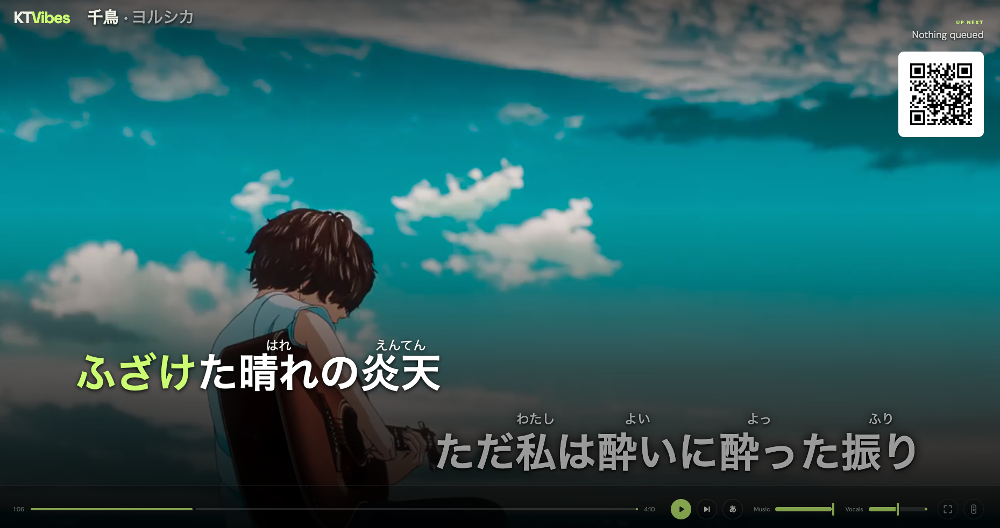
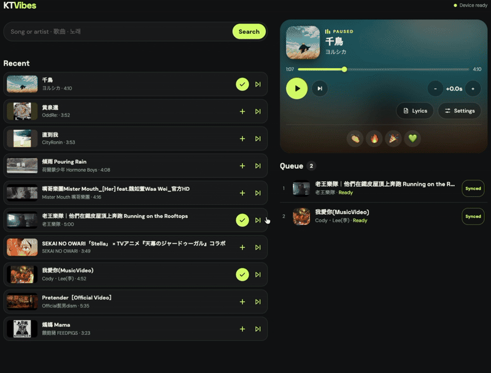
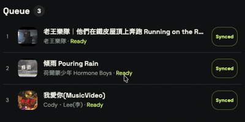
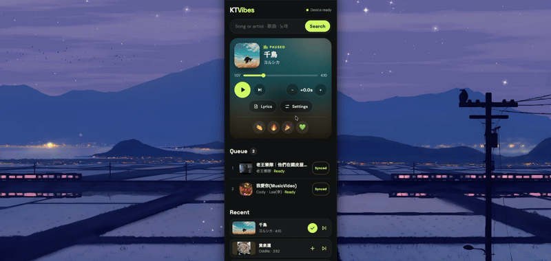

# KTVibes

An independently maintained fork of [KTVibes by Andrew Lee](https://github.com/andyleenz/KTVibes). This fork keeps the KTVibes name and MIT license. For features and instructions shared with the original project, see the [upstream README](https://github.com/andyleenz/KTVibes#readme).

### Japanese furigana alignment

Furigana stays aligned with its kanji as lyrics highlight during playback.



### Mobile lyrics

Open a dedicated lyrics viewer from the phone remote. Search LRCLIB with parsed title terms or your own query, preview results, and choose synced or plain lyrics. Mark a song as having no suitable lyrics when lookup finds no match.



### Remote queue management

See each queued song's lyrics status, change the song order, insert a song to play next, and remove songs from the queue.



### Wide-screen remote

On wide screens, the remote uses a two-column layout for song lists and playback controls.



## Install this fork

### Windows

Download `KTVibes-Setup-x64.exe` from the [latest KTVibes release](https://github.com/JeffShih-wiwynn/KTVibes/releases/latest) and run it. The unsigned installer may trigger a Windows SmartScreen warning.

Choose an install folder during setup. The application, its private runtimes, songs, lyrics, queue and models are stored there. Reinstalling preserves `cache/`; uninstall asks whether to remove it.

### macOS

Download `KTVibes-<version>-AppleSilicon.dmg` from the [latest KTVibes release](https://github.com/JeffShih-wiwynn/KTVibes/releases/latest), open it, and drag KTVibes to Applications. This build supports Apple silicon Macs only and uses ad-hoc signing; it has no Developer ID signature or notarization, so macOS may still require you to approve it in Privacy & Security. The app downloads its private Python, Node.js, FFmpeg and Python packages when it starts; this first setup can take several minutes.

The app is installed in Applications; its private runtime, songs, lyrics, queue and models stay in `~/Library/Application Support/KTVibes`. Replacing the app during an update preserves that folder. Removing KTVibes from Applications leaves it in place; remove it separately if you want to delete the cache.

### Desktop network settings

On macOS and Windows, choose **Network Settings…** from the menu bar or system tray. The window shows the current Remote address and a copy icon. Expand **Advanced settings** to select an active IPv4 network adapter or change the port. Automatic network selection and port `8765` are the defaults; Reset restores them.

Apply restarts the server. On macOS, it opens the player at the new address; on Windows, the settings window closes after the server restarts and the settings are saved. Playback is interrupted and the saved queue is restored; phones may need to scan the new QR code. If the preferred port is unavailable, KTVibes tries the next four ports, followed by five ports starting 10000 above the preferred port, within the valid port range. If all candidates fail, the desktop menu shows Port conflict and links to Network Settings. A failed restart restores the previous configuration. When the automatically detected IP changes, the TV address and QR refresh within about five seconds.

Settings are stored in `~/Library/Application Support/KTVibes/network.json` on macOS and `%LOCALAPPDATA%\KTVibes\network.json` on Windows. Saved desktop settings take precedence over `KTVIBES_PORT` and `KTVIBES_ADVERTISE_IP`; source launches continue to use environment variables. `KTVIBES_REMOTE_URL` remains available for source/self-hosted deployments with a custom external URL. Selecting an IP changes the advertised Remote address; the server continues listening on all IPv4 interfaces.

### Linux

The installer requires Git, FFmpeg and Node.js 22 or later. It installs uv, clones this fork's `dev` branch into `~/KTVibes`, installs Python dependencies and adds a `ktvibes` command:

```bash
curl -LsSf https://raw.githubusercontent.com/JeffShih-wiwynn/KTVibes/dev/install.sh | bash
```

If you prefer to install from source:

```bash
git clone --branch dev https://github.com/JeffShih-wiwynn/KTVibes.git
cd KTVibes
uv sync
uv run ktvibes
```

For Python and Remote browser test commands, see [Testing](docs/testing.md).
For module responsibilities and dependency boundaries, see [Code structure](docs/architecture.md).

## Updates

- When a newer stable release is available, the Remote shows an update icon. Open it to see the version and the GitHub Release page; downloading and installing remain manual.
- **Windows:** Download and run the newer installer. It updates the application in the selected folder and keeps `cache/`.
- **macOS:** Replace KTVibes in Applications with the newer app. Your songs, lyrics, queue and models remain in Application Support.
- **Linux:** Stop KTVibes and run `ktvibes update`. Your songs, lyrics and queue remain in the cache.

## Upstream and license

This project is based on [andyleenz/KTVibes](https://github.com/andyleenz/KTVibes). The upstream MIT license and copyright notice are retained in [`LICENSE`](LICENSE). Changes in this fork are maintained independently.
